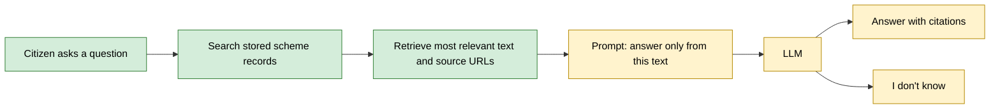

# How LLMs Work (and How SchemeSaathi Uses Them)

SchemeSaathi helps citizens find Indian government schemes, understand who is eligible, what the benefits are and which documents are needed. Our data comes from the official myScheme portal (https://www.myscheme.gov.in). This note explains the basics of LLMs and how SchemeSaathi plans to use one safely.

## 1. What is an LLM?

LLM stands for large language model. It is trained to predict the next word (more exactly, the next token) from the words that came before it, and it repeats this again and again to write a full answer. For example, in "This is an apple and it is a ___", the word "fruit" fits better than any other word. By default an LLM does not search the internet; it only uses what it learned in training and the text we give it in the prompt.

## 2. Tokens and the context window

An LLM does not read a paragraph like a human; it first breaks the text into tokens, which are small pieces of text and not always full words. The context window is the maximum amount of text the model can handle at one time, including the question, any extra text we give it and its own answer. If we give more than that, the oldest messages get dropped or the end of the prompt gets cut off (depending on the app), so the model never sees it. This is why SchemeSaathi cannot send every scheme in every request and has to pick only the relevant ones.

## 3. Training vs using it

Training is when the model learns patterns from a huge amount of text. It takes a lot of time and money and happens before we use the model. Using it is called inference: the model's learning is fixed and it only predicts an answer from the prompt, so it does not train again every time we ask a question, and it does not remember our question afterwards. Fine-tuning means training an already trained model a bit more on a small dataset, which is cheaper than training from scratch, but it does not guarantee the model will stop making mistakes.

## 4. Why it makes things up

An LLM writes the most likely-sounding next words and does not check facts, so when it does not know something it can still write a confident but wrong answer. This is called hallucination, and the model does not know that it is wrong. For SchemeSaathi this is risky: a citizen could be told they are eligible when they are not, or miss a scheme they qualify for, and waste time or money. The same question can also get a different answer each time, so people should not trust a generated answer blindly.

## 5. How SchemeSaathi handles this

SchemeSaathi plans to use RAG (retrieval-augmented generation): first search our stored scheme records, which are collected from the official myScheme portal, then give only the matching text and its source URL to the LLM. The prompt will tell the LLM to answer only from that text and to say "I don't know" when the answer is not there, for example a deadline we have not stored. Every answer will carry a source link so the user can check it. This reduces wrong answers but does not remove them completely, and the answers are only as up to date as our stored data.

## Planned architecture

This is the planned design. Green steps already exist; yellow steps are planned.

## Current status

- **Built:** `GET /search` ranks records with TF-IDF and cosine similarity, and `POST /questions` returns the best-matching schemes with their source URLs.
- **Planned (not built yet):** the LLM, the prompt that restricts answers to retrieved text, citations in generated answers and the "I don't know" behaviour.

## Ten SchemeSaathi user questions

These are proposed test questions. "Answerable" was checked against the nine records that currently have full details.

| # | Question | Answerable from our records? |
|---|---|---|
| 1 | I'm 25 years old. Can I enrol in Atal Pension Yojana? | Yes (age 18 to 40) |
| 2 | What insurance coverage does PMJJBY provide? | Yes |
| 3 | I sell vegetables on a cart. Can I get a working capital loan without collateral? | Yes (PM SVANidhi) |
| 4 | What benefits does PM Vishwakarma provide to traditional artisans? | Yes |
| 5 | Who is eligible for rural housing assistance under PMAY-G? | Yes |
| 6 | What is the current application deadline for PM-KISAN? | **No.** No deadline is stored, so SchemeSaathi must say it does not know. |
| 7 | Can a farmer who pays income tax receive PM-KISAN benefits? | Yes (income-tax payers are excluded) |
| 8 | What is the annual financial benefit provided under PM-KISAN? | Yes |
| 9 | Who can apply for the DPIIT Internship Scheme? | Yes |
| 10 | What is the next intake date for the DPIIT Internship Scheme? | **No.** No intake dates are stored. |
